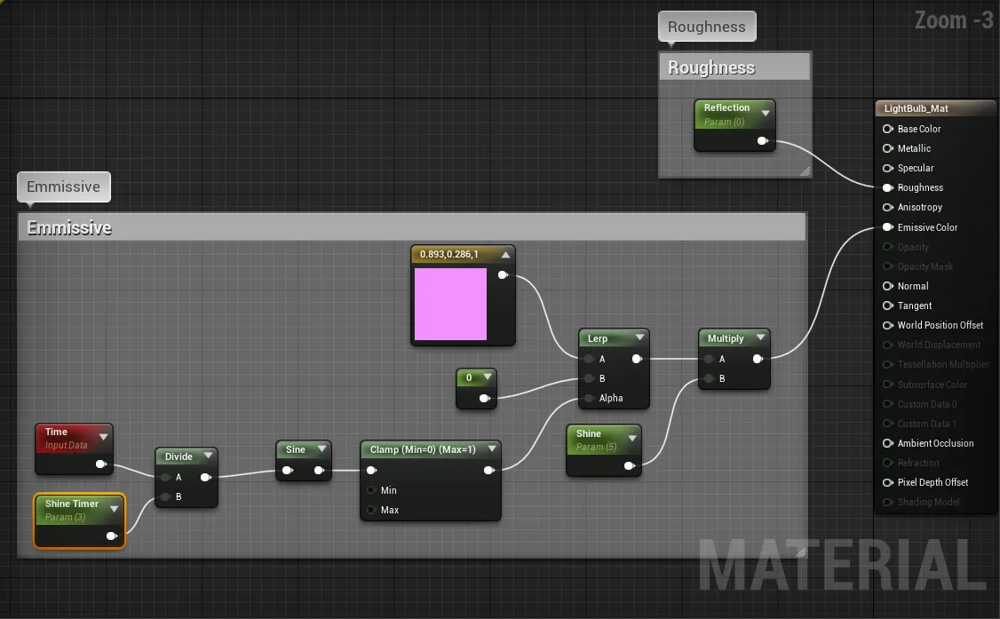
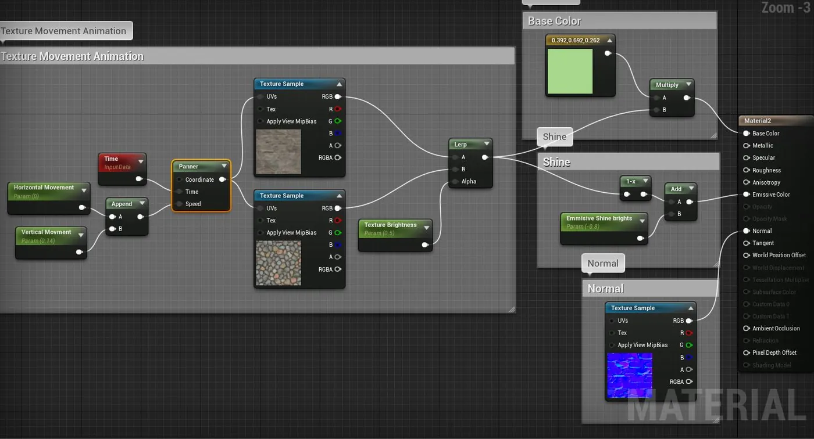
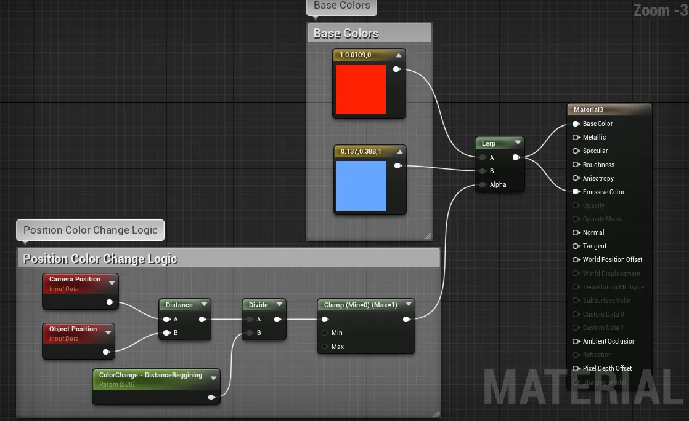

# Reverse-Engineering Materials — Report

> English translation of the original report (Spanish) written for *Video Game Technologies and Virtual Environments II* (ESNE). Practice 1: Materials.
> Author: Miguel Rodríguez Gallego.

The exercise: study three materials shown in class, explain how each node works, think of uses for them and rebuild each one in Unreal Engine.

## Material 1 — Flickering emissive

### 1. Description and construction

The material blinks by raising and lowering its emissive value over time.

### 2. How the nodes work

- **Parameters**: values that can be changed at runtime to modify the material.
- **Constant3Vector**: outputs a three-channel vector as a value. It works with RGB values.
- **Multiply**: multiplies two inputs into one result. It keeps the darker pixels.
- **Lerp**: linear interpolation between two values A and B according to the Alpha input. It blends both inputs evenly, but changing Alpha (or driving it with an external alpha) takes more from one than from the other.
- **Clamp**: returns the value limited to the range [A, B] (inclusive).
- **Sine**: produces a sine wave, i.e. a curve that represents periodic oscillations of constant amplitude.
- **Time**: global input driven by the engine's internal clock. It links the material to the passing of time.

### 3. Possible uses

- Horror games: flickering lamps.
- Combined with the panning material (Material 2), it can be used for flare effects.
- Lighthouses.
- Flashlights.

### 4. My version

## Material 2 — Panning texture

### 1. Description and construction

The texture scrolls upwards by moving the base color.

### 2. How the nodes work

Nodes already explained in the previous material are not repeated.

- **Texture Sample**: brings a texture of any type (base color, normal, roughness…) into the node graph.
- **Add**: keeps the brighter pixels of the two inputs. It is mostly used to raise or lower the brightness of a texture.
- **Panner**: takes Coordinates and Time and outputs the scrolled UVs.
- **Append**: concatenates two values into a vector with more channels.

### 3. Possible uses

- Flares.
- Water: rivers and streams.
- Movement effects in the distance.
- Quicksand or lava.
- Animated wallpapers on computer screens in an office or room.

### 4. My version

## Material 3 — Color by distance to the camera

### 1. Description and construction

As you get closer, the material measures how far the player is and changes its color accordingly: blue from far away, red up close.

### 2. How the nodes work

Nodes already explained in the previous materials are not repeated.

- **Divide**: divides the first input by the second.
- **Distance**: Euclidean distance between two points, colors, positions or vectors. It works with 1–4 component vectors, but both inputs must have the same number of channels.
- **Camera Position**: three-channel vector with the camera position in world space.
- **Object Position**: world-space position of the center of the object's bounds.

### 3. Possible uses

- Enemies: highlight them the closer they are, as visual feedback that the player is in danger.
- Pickups: make them stand out when the player is near so they are easier to see and collect. Combined with a fresnel it would be ideal.

### 4. My version

