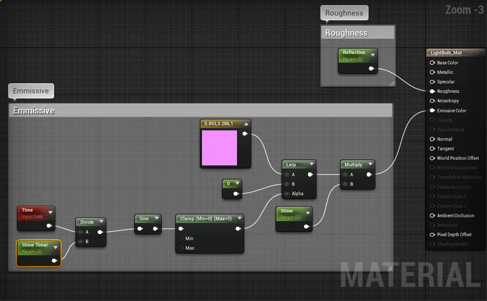
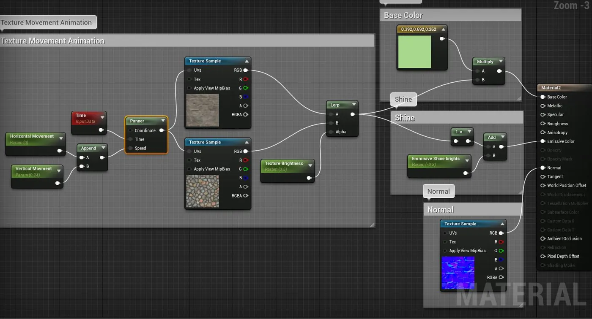
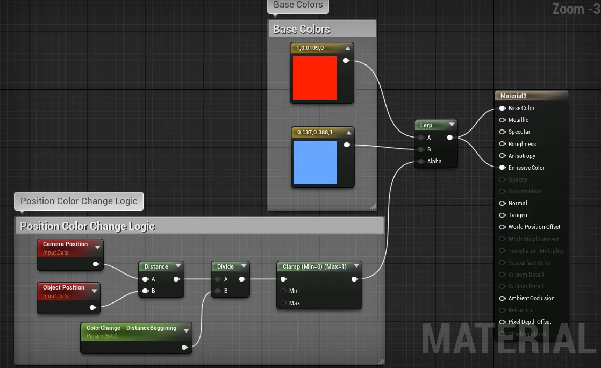

# 01 · Materials

Material-graph exercises for the course *Video Game Technologies and Virtual Environments II* (ESNE).
The goal was to understand how the Material Editor nodes work by building materials from scratch,
reverse-engineering given materials and applying them to a themed scene.

**Engine:** Unreal Engine 5.8 · **Tech:** Material Editor · **Report:** [Docs/Report.md](Docs/Report.md)

| Flickering emissive | Panning texture | Colour by distance |
|:---:|:---:|:---:|
|  |  |  |

## What's inside

| Map (`Content/Scenes/`) | Content |
|-------------------------|---------|
| `1_Materiales` (default map) | Material exercises 1–13 |
| `2_IngenieriaInversaMateriales` | The three reverse-engineered materials |
| `3_Oficina` | The materials applied to an office scene |

| Folder (`Content/Materials/`) | Content |
|-------------------------------|---------|
| `Exercises/01_Basics` … `13_Extra` | One folder per exercise: colours, emissive, lerp blends, texture coordinates, physically based surfaces, multiply/add/lerp, greeble masks, water, air, glass, diamond, ice, animated water, fresnel, a master material with instances, decals, opacity / translucency, two-sided |
| `ReverseEngineering` | `M_FlickeringEmissive`, `M_PanningTexture`, `M_DistanceColor` |
| `Office` | Variants used in the office scene (metals, light bulbs, moving textures, decals…) |
| `Shared` | Floors, doors, wood, concrete and brass used by several scenes |
| `Textures` | Procedural textures made for the project (cloud noise, cracked earth, greeble masks, blood splat, carpet, lab logo) |

### Reverse-engineered materials

1. **Flickering emissive** — `Time` → `Sine` → `Clamp` drives the emissive intensity. Use cases: flickering lights in horror games, beacons, flashlights.
2. **Panning texture** — `Panner` + `Texture Sample` moves the base colour over time. Use cases: rivers, lava, animated screens.
3. **Colour by distance** — `Distance(CameraPosition, ObjectPosition)` / range → `Lerp` from blue (far) to red (near). Use cases: highlighting nearby enemies or pickups (combined with fresnel).

## Where my work is

- `Content/Materials/` — all the materials and the procedural textures
- `Content/Scenes/` — the three maps

`Content/StarterContent/` (Epic Games) provides the remaining textures and meshes; only the assets
the scenes use are kept.
