# Multiplayer FPS — Report

> English translation of the original report (Spanish) for *Digital Post-production*, Game Design & Development degree, 4th year (UDIT). First practice of the first semester, 2023/24.
> Asset names are those of the original submission; the project README lists the current ones.
> Author: Miguel Rodríguez Gallego.

## Introduction, goals and motivation

### Introduction

A multiplayer game prototype built in Unreal Engine 5 with Blueprints.

### Goals

- Learn how multiplayer games are developed, studying how networked actors work and connect with each other to drive the flow of a match.
- Build a complete FPS with the basic features.
- Study tools such as Blueprint visual scripting, debugging and a UI that presents the game as a real one would.

### Motivation

Learning the basics of multiplayer development.

## Research

### Unreal's Gameplay Framework

- **Definition**: the Gameplay Framework gives an organised structure to build game logic and user interaction.
- **Modular structure**: it manages players, controllers, characters, etc. as separate pieces.
- **Actors and components**: actors are the game entities (characters, enemies, objects…); components are the modules that make up an actor and define its functionality.
- **GameMode and GameState**: the GameMode defines rules and settings (number of players, match time); the GameState stores the current state of the match (scores and other global data).
- **PlayerController and PlayerState**: the PlayerController handles user input and the communication between player and game; the PlayerState stores persistent information about the player, such as the score.
- **GameInstance and HUD**: the GameInstance keeps data that must persist between levels and global settings; the HUD shows UI information during play, such as scores and messages.
- **Gameplay tags and categories**: tags categorise and organise game elements; categories organise assets in the editor so they are easier to find.
- **Flow control**: level sequences create in-game events and cinematics.
- **AI Controller**: drives the behaviour of AI characters.

*(Gameplay Framework Quick Reference, Unreal Engine documentation)*

### Blueprints and multiplayer

**Basics**

- Blueprints is Unreal's visual scripting system. It lets developers build game logic without writing code, using a node graph.
- Nodes represent actions and functions; the connections between them define the flow of the logic. There are nodes for maths, game events, custom functions and more.
- Blueprints react to events such as input, collisions or custom events.
- Variables store data such as a character's health or the score, and change during play.
- Loops and conditionals control the flow of execution.
- Blueprints are also used to create classes (characters, weapons…) and configure their properties visually.

**Blueprints in multiplayer**

- Networking logic can be built with nodes, including the synchronisation of information between clients and server.
- **Replication** keeps actions and states in sync between server and clients; replicated variables make sure every player has up-to-date information.
- **Network functions** (custom events) can be set to run on the server, on the owning client or on every client.
- Network events allow specific responses, and the important game state can be synchronised when a new player joins.

*(Multiplayer in Blueprints, Unreal Engine documentation)*

### Input system

- Unreal's input system handles keyboard, mouse, controller and other devices from a central, configurable place.
- **Mappings**: keys or buttons are mapped to game actions, configured visually in the editor.
- **Axes and actions**: analog input (mouse, sticks) and single presses are both supported.
- **Blueprints**: input events are handled directly in Blueprints to drive the game logic.
- **Multiplayer**: the effects of input are replicated so that server and clients stay consistent.
- **Customisation**: players can remap the button assigned to an action.

*(Unreal Engine 5.3 documentation)*

### Destruction system (Chaos Destruction)

- Unreal's destruction system creates environments and objects that can be damaged or destroyed during play, using physics simulation for realistic results.
- In Unreal Engine 5 it is built on the **Chaos** physics tools.
- Destruction logic can be written in Blueprints or C++, and destruction can be handled through specific events and functions.
- Objects can be fractured into pieces in advance (geometry collections) or break dynamically according to the applied force.
- In multiplayer, destruction can be replicated so all players see the same result.
- Destruction is expensive, so optimisation matters when there are many destructible objects.

*(Unreal Engine 5.3 documentation)*

## Technical description — player and projectiles

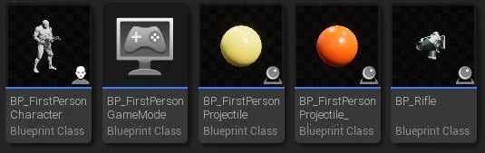

### Player initialisation

A custom event called `Initializations` sets up the UI and the player's variables when the player appears in the world, and it is called again whenever someone dies.

It initialises health, bullets, magazines, energy, damage type, the health and energy bars, the potion, the spawn point and the death panel (hidden on spawn).

### Input system

Two input mapping contexts with their actions:

- `IMC_Default`: movement and health actions.
- `IMC_Weapons`: attack actions — shooting, energy and weapon change.

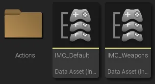
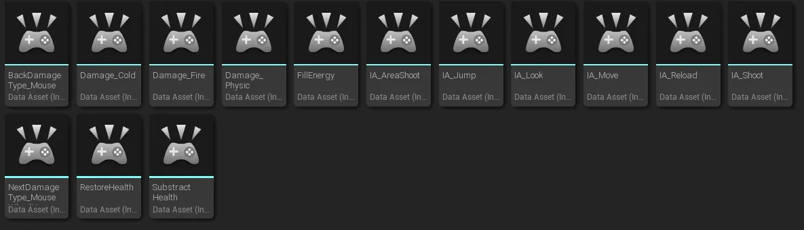

### Interface

All match information is updated on screen in real time, mostly in the bottom-left corner. Values are bound to internal text and numeric variables.

It is created and initialised with *Create Widget*, *Add to Viewport* and `Initializations`. It also contains a hidden red panel shown when the player dies.

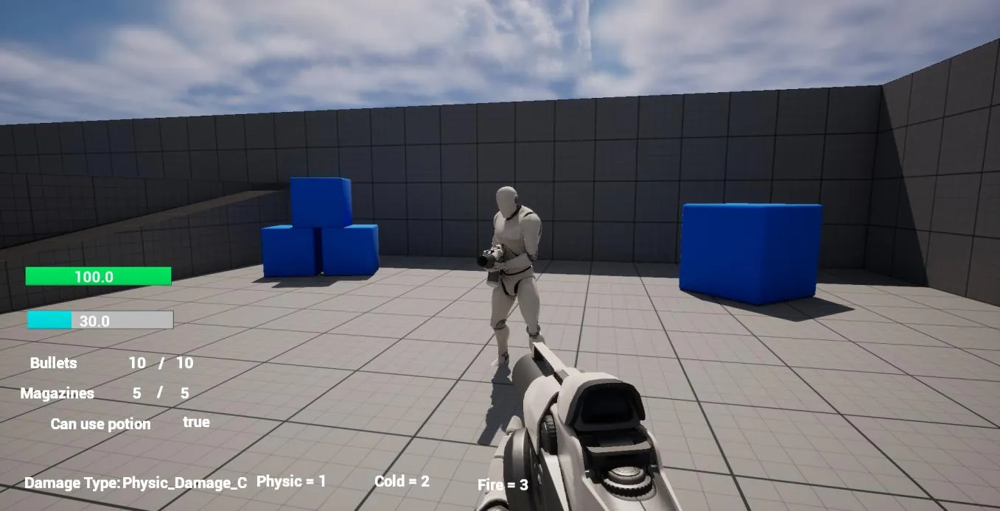

### Movement

Based on the movement functions of Unreal's sample project, slightly modified.

**Walking** — W (forward), A (left), S (back), D (right).
The player walks in any direction with a leg animation that does not interfere with the arms animation. Only the player's position vector moves; its child components move with it. It mainly uses *Add Movement Input*, which already handles smooth movement from the given vector and the player's input through the input system.

**Jumping** — Space bar.
A vertical force lifts the player a few centimetres to get over obstacles, using Unreal's physics. Two functions: *Jump* applies the vertical force, *Stop Jumping* detects the end of the action so the player can jump again.

**Camera** — mouse.
The camera from Unreal's FPS sample, attached to the head. It follows the player's actor and rotates with the mouse input on the X and Z axes.

- *Add Controller Yaw Input* and *Add Controller Pitch Input*: basic camera control from the mouse values; the pitch also drives the weapon animation so others can see whether the player is aiming up or down.
- *Refresh Camera Rotation*: computes the camera rotation.
- *Calculate Pitch*: computes the pitch.

The local camera only sees the player's own arms and hides the full body for that player; the full body is shown to everyone else. The same applies to the other players.

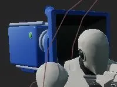

### What other players see — pitch calculation

Based on the client's input, this updates how the character looks on the server. The mouse values drive the camera and the aiming animation, which was split into three single-frame poses (up, middle, down) blended in an aim offset.

- *Refresh Camera Rotation* (runs on server): updates the camera with *Set World Rotation*.
- *Calculate Pitch* (Run on Server custom event): sets the pitch from the user's input.
- *Replicate Pitch To Clients* (Multicast custom event): replicates the values so everyone sees the change.

### Shooting

**Spawn.** The bullet spawns a few centimetres in front of the player to avoid colliding with the shooter; there are also explicit checks so a player's own bullet does nothing to them. *SpawnDirectProjectile* spawns the `BP_FirstPersonProjectile` actor.

**Cooldown.** Limits how often the player can fire: the normal bullet has a 1.5-second cooldown (a *Delay*); the explosive bullet has no cooldown.

**Damage handling.** Events such as *PointDamage* and *RadialDamage* receive the hit information (where one object collided with the other).

**Damage types.** Three types: physical, fire and cold. They are switched with the mouse wheel or the 1–3 keys. The damage type only matters for the immunity system. The switch is driven by an array and internal functions.

**Sound.** *Play Sound at Location* plays the shot at a given position as audio feedback; a montage is also played on the player.

### Projectile types

#### Direct projectile — left click

Fires a yellow bullet that deals 10 damage and gives the shooter 10 energy, using one bullet from the magazine.

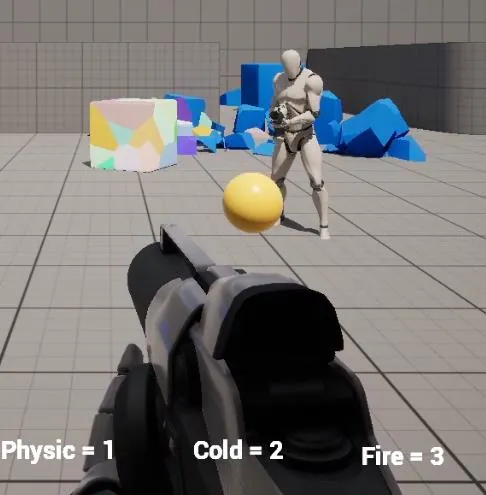

Player side:

- *OnFireProjectile*: handles the consequences of firing — one bullet less in the magazine and +10 energy if the bar is not full.
- *SpawnDirectProjectile* (Run on Server): spawns the bullet on the server so everyone sees it and can be hit by it.
- *PlayShotSFX* (Multicast): shot sound effect.
- *Delay*: blocks firing for 1.5 seconds.
- *Event PointDamage*: reads the damage data from the bullet to change the target's health.
- *Check Death*: if health reaches 0, starts the death process.

Bullet side:

- *Get direction*: direction of travel (*Get Velocity* + *Normalize*).
- *Add Impulse*: pushes the projectile forward with physics so it moves realistically (*Is Simulating Physics*, *Get Velocity*, *Get Actor Location*, *Add Impulse at Location*).
- *Apply Damage* to the actor it hits, and *Print String* to show the action on screen.
- Combo functions that check whether the player chained several hits, to reward them with a magazine.
- *ImmunityLogic*: reads the damage type and the hit counter to decide whether the enemy builds immunity to that damage type.
- *Combat Log*: prints what happens in the match.
- *Destroy Actor* once all the logic has run.

#### Area damage and destruction — right click

Fires a bullet moved by a physics impulse; when it hits a surface it deals damage in an area. It does not use magazine bullets.

- *Event Hit*.
- *Add Impulse at Location*: pushes everything around like a bomb.
- *Add Transient Field* with a *Radial Falloff*: defines the blast wave and its radius, breaking Chaos geometry collections.
- *Print String* for debugging.
- *Apply Radial Damage*.
- *Destroy Actor* once all the logic has run.

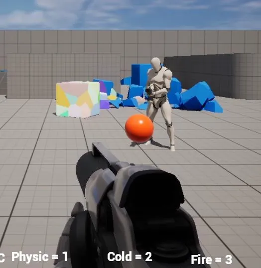
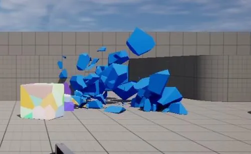

### Reloading — R

Takes one magazine from the reserve to refill the current one, with a 1-second cooldown. *Reload Event* (Multicast) performs the reload with checks so the magazine and bullet limits are never exceeded.

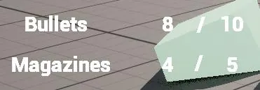

## Health system

### Damage

A green health bar holds a float from 0 to 100. It goes down with the damage received from enemy bullets through *Apply Point Damage* or *Apply Radial Damage*. Basic checks look at the player's state before applying the damage and then check whether the player died.

Supporting functions:

- *CheckHealth* (Run on Owning Client): checks the player's death.
- *RestoreHealth* (Run on Owning Client): restores 70% of the health.

### Potion

When health drops below 70% the player can drink a potion, with a 60-second cooldown implemented with a *Delay* and checks on the `Health` variable and the `PotionTimer`.

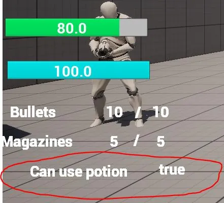

### Death

Runs when health reaches 0. A red panel tells the player they died and their input is blocked for 10 seconds. After that they continue with their variables reset by `Initializations`.

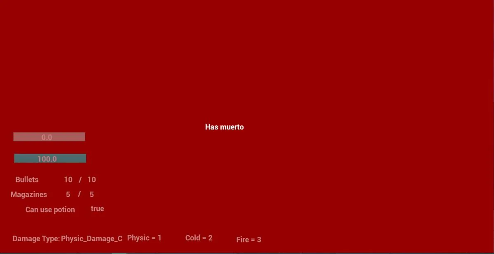

### Immunity

Functions check the damage type of each hit and, with a counter per damage type, decide the final damage according to the target's immunity: 1st hit = 100%, 2nd = 50%, 3rd = 25%, 4th = 0%.

## Resource systems

### Debug / combat log

Prints the match information as a list in the top-left corner, using *Print String* with *Append* to format the tags. When a bullet hits an enemy player it logs who received the damage, how much, the damage type, the cause and who caused it.

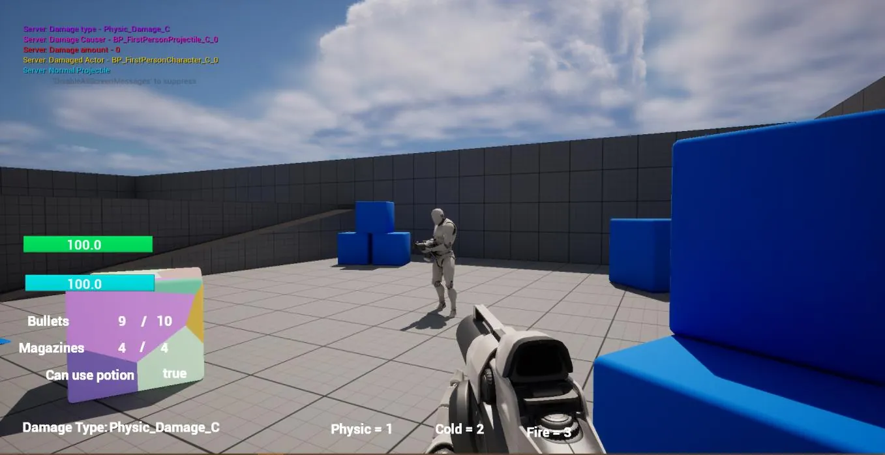

### Energy

A normal shot gives +10 energy; an area shot costs 70 energy. Checks keep the value between 0 and 100.

### Bullets and magazines

Without bullets the player cannot shoot, and they can reload a full magazine if there are any left in reserve. It is all driven by checks on `Magazines`, `MaxMagazines`, `Bullets` and `MaxBullets`, shown through `BulletsText` and `MagazinesText`.

## Online — how players see each other

The character Blueprint and its component settings make sure that other players see the full-body mesh, while the local first-person player only sees the arms, so there are no visibility problems.

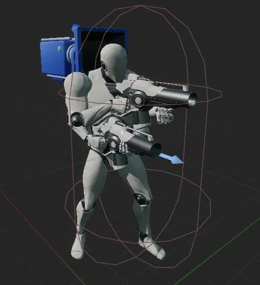

## Development log, obstacles and lessons learned

The project was hard at first because I had never programmed with Blueprints, but it became easy and intuitive once I learned how they work.

A real obstacle was finding information about some functions, even in Unreal's official documentation, so I often had to learn by trial and error.

Deciding how each custom event had to be replicated, depending on its role, also caused many problems when structuring the code.

It also took me a while to understand the pitch system that makes the model seen by other players rotate to follow where the player is looking, although it was simple once I understood it.

The visual chaos of having many Blueprint nodes in some actors, such as the main character, which contained a lot of logic, was another problem.

At first, destroying obstacles caused trouble too: debris could end up in one place for one player and somewhere else for the other, which breaks the colliders completely and can leave a player stuck.

The logic of most functions was simple. The problems came from not understanding Unreal's methodology yet, above all which information had to be replicated on the server, the client or both depending on the internal logic.

The parts I did not finish, apart from the optional requirements, were left out because of time rather than difficulty; with the time spent on it in class, the practice was very approachable.

## Bibliography

Unreal Engine documentation (no date):

- *Gameplay Framework Quick Reference* and *Gameplay Framework*.
- *Blueprints* and *Networking with Blueprints*.
- *Input*.
- *Chaos Destruction* and *Destruction*.
