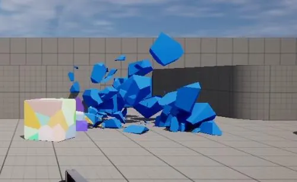
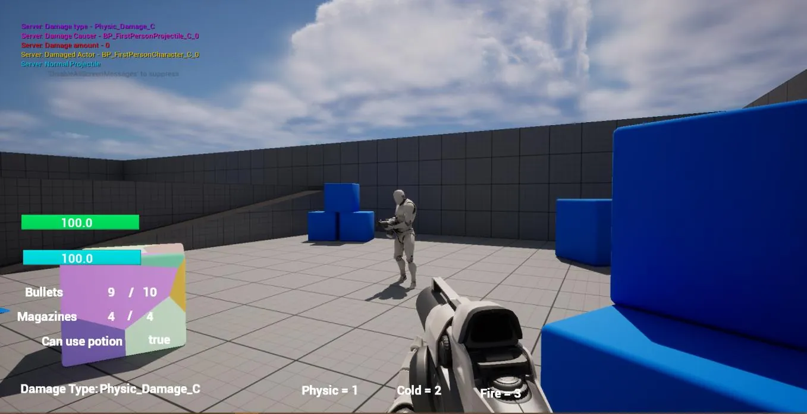
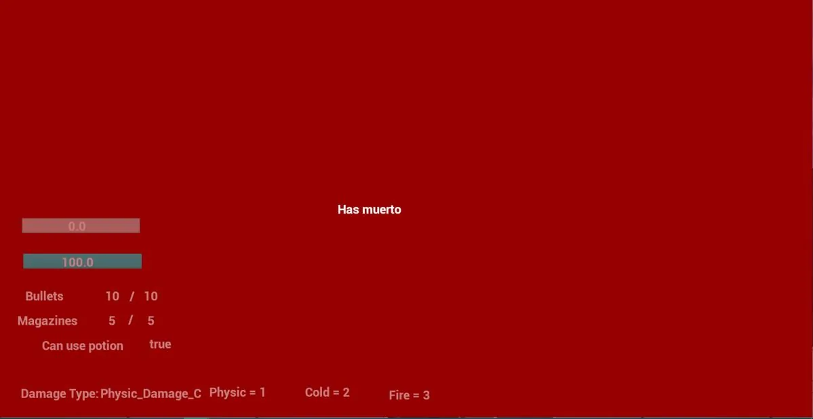

# 02 · Multiplayer FPS

A networked first-person shooter prototype made entirely with Blueprints for the course
*Digital Post-production* (UDIT, 2023/24). The focus was learning Unreal's gameplay framework and
replication: what runs on the server, what is multicast, and what each client sees.

**Engine:** Unreal Engine 5.8 · **Tech:** Blueprints, Enhanced Input, Chaos Destruction · **Report:** [Docs/Report.md](Docs/Report.md)

| Area shot breaking Chaos geometry | Combat log | Death screen |
|:---:|:---:|:---:|
|  |  |  |

## Features

- **Replicated aiming** — the camera pitch is calculated on the server (*Run on Server*) and multicast to every client, driving a 1D aim offset built from three poses so other players see where you are looking.
- **First/third-person visibility** — the local player only sees their arms; everybody else sees the full body.
- **Two fire modes**
  - *Direct projectile* (LMB): spawned on the server, 10 damage, +10 energy, uses ammo, 1.5 s cooldown.
  - *Area shot* (RMB, costs 70 energy): physics-driven projectile that applies radial damage, impulses and a transient field to break **Chaos geometry collections**.
- **Damage types** — physical, fire and frost (mouse wheel or 1–3). Repeated hits with the same type build **immunity**: 100% → 50% → 25% → 0% damage.
- **Health, potion and death** — health bar, potion that heals when below 70% (60 s cooldown), death screen and 10 s respawn lock.
- **Ammo & magazines** with reload (R), plus a hit combo that rewards a magazine.
- **Combat log** on screen: who was hit, damage, type, cause and instigator.
- **Enhanced Input** with two mapping contexts: `IMC_Default` (movement, health) and `IMC_Weapons` (shooting, energy, damage type).

## How to try it

Open `Project/MultiplayerFPS.uproject`, then in the Play options set **Number of Players = 2** and
**Net Mode = Play As Listen Server**. The map is `FirstPerson/Maps/FirstPersonMap`.

## Where my work is

| Folder (`Content/`) | Content |
|---------------------|---------|
| `MultiplayerFPS/Blueprints/` | `BP_FPSCharacter`, `BP_FPSGameMode`, `BP_FPSPlayerController`, `BP_DirectProjectile`, `BP_AreaProjectile`, `BP_Rifle` |
| `MultiplayerFPS/Blueprints/DamageTypes/` | `DT_Physical`, `DT_Fire`, `DT_Frost` |
| `MultiplayerFPS/Input/` | Mapping contexts and input actions (`IA_Shoot`, `IA_AreaShoot`, `IA_NextDamageType`, `IA_RestoreHealth`…) |
| `MultiplayerFPS/UI/` | `WBP_HUD` |
| `MultiplayerFPS/Animations/AimOffset/` | Aim poses and the `AO_Aim` aim offset |
| `Destructive/`, `Destructive_Greometry/`, `SM_My_GeometryCollection` | Destructible geometry collections placed in the map |
| `FirstPerson/Maps/FirstPersonMap` | The level |

Built on the First Person template. `AnimStarterPack`, `FPWeapon`, `FirstPersonArms` and
`LevelPrototyping` are Epic / Fab content (unused assets removed).

> The map and the geometry collections keep their original paths: the map stores each actor in its
> own file (One File Per Actor), and those files reference them by path.
