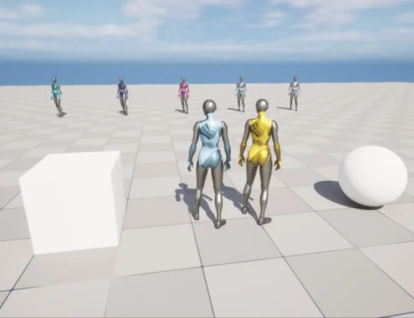
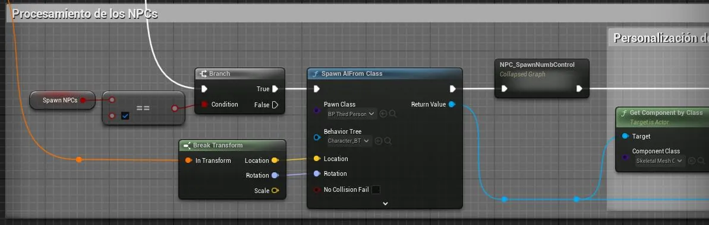
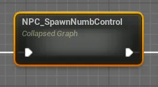
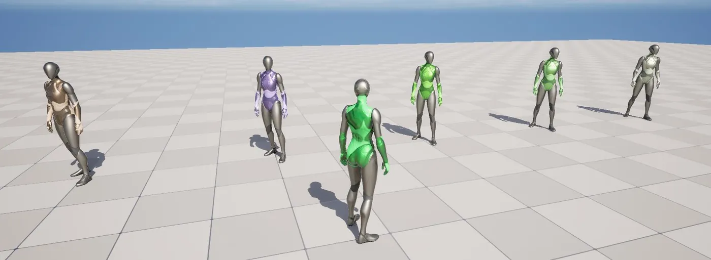
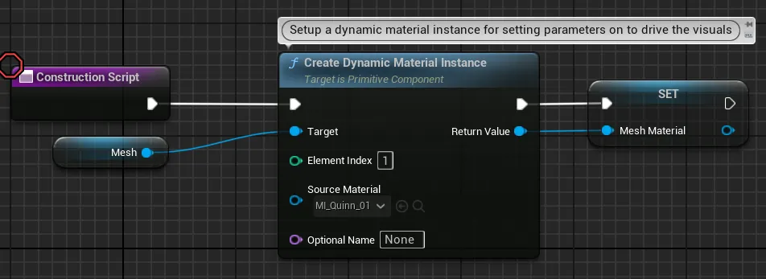
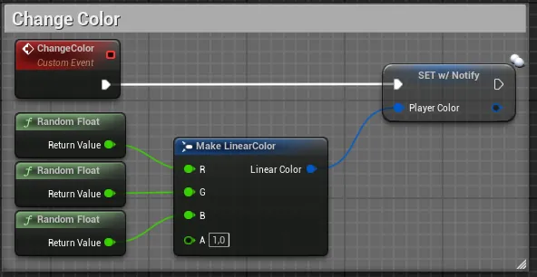
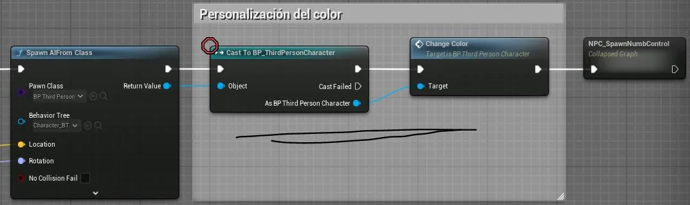
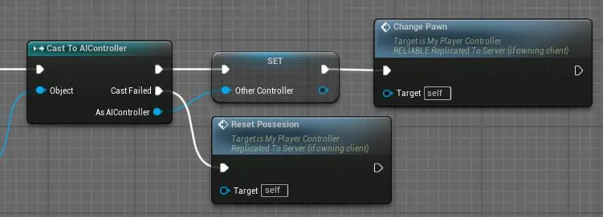
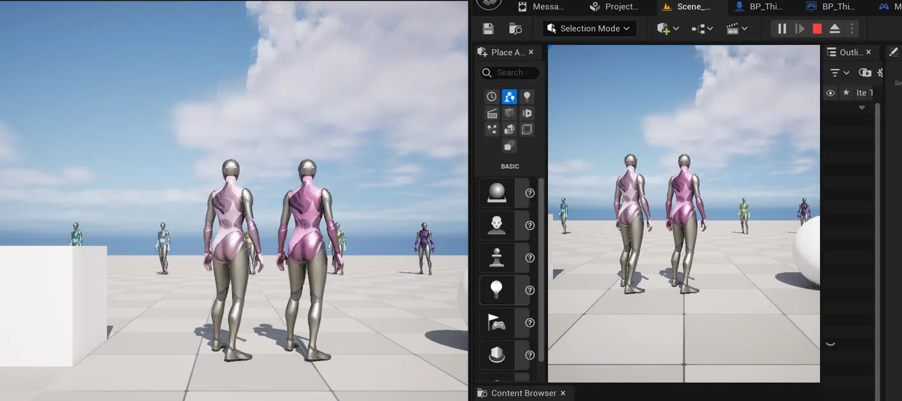

# Multiplayer Pawn Swap — Report

> English translation of the original report (Spanish) for *Digital Post-production*, Game Design & Development degree, 4th year (UDIT). Second practice of the first semester, 2023/24. Submitted 11/01/2024.
> Asset names are those of the original submission; the project README lists the current ones.
> Author: Miguel Rodríguez Gallego.

## Introduction

A 3D multiplayer project in Unreal Engine 5 with a level that contains spawn points for players and for idle AI characters.

Every character spawns with a random color so they can be told apart, and every player sees the same colors and movements, replicated by the server.

Players can bump into an AI character to swap pawns, i.e. to take control of that character. A player cannot swap with a character that is already controlled by another player.

## Goals

- Control over playable character pawns.
- Learn RepNotify variables to replicate data to every client in real time.
- Change colors and materials in a level.
- Node-based programming.
- Adapt these concepts to a multiplayer environment.

## Activities and technical description

### 1. Character spawning

Two players and five AI characters. Everything is handled in `BP_ThirdPersonGameMode` with a simple process:

1. Get every spawn-point actor placed in the level.
2. Loop over them and check each one's tag to know whether it is a player or an AI spawn point.
3. Player: spawn, possess and assign a color.
4. AI: add one to the AI counter (out of 5), spawn, assign a color; the next AI uses the next spawn point, not the same one.

I also fixed a bug with the number of characters spawned when the match starts, using a boolean and a counter of spawned characters that stops at the number of spawn points placed in the level (5 in my case). The boolean then closes the loop once every point has been used.

### 2. Random color for players and AI — RepNotify

I designed the color system around RepNotify variables, which are replicated: they keep the server and client data in sync so the game stays consistent over the network.

#### Variables

- `PlayerColor`: color applied to the character's material.
- `MeshMaterial`: reference to the character's material, used to apply the color.

#### Creating the dynamic material

The Construction Script of `BP_ThirdPersonCharacter` creates the dynamic material instance used to change the character's color.

#### Color change method

Also in `BP_ThirdPersonCharacter`. It sets the RepNotify variable with a random color so the change is replicated.

#### Calling the method

`BP_ThirdPersonGameMode` calls it right after spawning a player or an AI, using the reference to the spawned character.

### 3. Bumping into characters / swapping pawns

In `MyPlayerController`. I kept the logic that came with the base project and only fixed one thing: after bumping into a character controlled by another player, the swap stopped working. On the *Cast Failed* branch of the swap attempt I now call *Reset Possession*, which re-initialises the system.

## Tests

1. Start a match as a listen server with two players.
2. Check that 2 players and 5 NPCs appear.
3. Bump into an NPC: the pawn swaps.
4. Bump into the other player: nothing happens and there is no error.
5. Bump into another NPC: it still works.

## Results

The project works correctly in every area. The material handling could probably be made a little more efficient, but the current method is efficient overall.

## Development log

Spawning came first and was simple; it only caused trouble later, when the color method needed references to the character Blueprint.

Color was the hard part. Getting the mesh reference to change the color correctly caused problems, and one bug cost a lot of time until the end: the vector parameter name set on the material had to match the parameter defined in the material (`Custom_Color`).

Finally I fixed the bumping system so it keeps working after a failed swap, which was not complicated: resetting possession and the delay.

## Bibliography

- *Changing material in multiplayer* (2021, June 1). Epic Developer Community Forums. <https://forums.unrealengine.com/t/changing-material-in-multiplayer/232937>
- OpenAI (2023). ChatGPT (January 11 version) [Large language model]. <https://chat.openai.com/chat>
