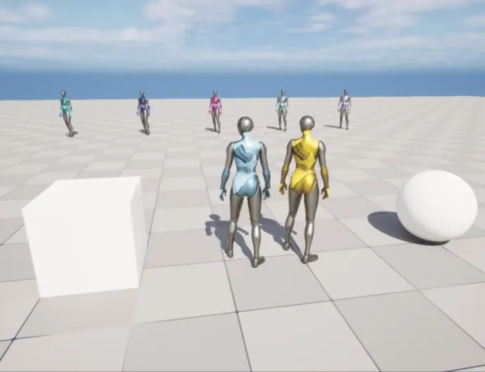
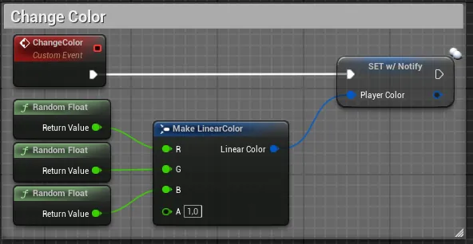

# 03 · Pawn Change

A multiplayer Blueprint project for the course *Digital Post-production* (UDIT, 2023/24): players
spawn next to idle AI characters and take control of them by bumping into them.

**Engine:** Unreal Engine 5.8 · **Tech:** Blueprints, replication (RepNotify) · **Report:** [Docs/Report.md](Docs/Report.md)

| Two players and five AI characters | Colour replicated with RepNotify |
|:---:|:---:|
|  |  |

## Features

- **Tag-based spawning** — `BP_PawnChangeGameMode` iterates the spawn points in the level, reads their tag and spawns either a player (and possesses it) or an AI. 2 players + 5 AIs; each AI goes to the next free point and a counter prevents over-spawning.
- **Replicated random colours** — every character gets a random colour stored in a **RepNotify** variable. The OnRep function updates a dynamic material instance (created in the construction script), so all clients see the same colours.
- **Pawn swapping** — colliding with an AI character transfers possession to it (`BP_PawnChangePlayerController`). You cannot take a pawn controlled by another player, and a failed attempt resets the possession system so you can keep swapping.

## How to try it

Open `Project/PawnChange.uproject` and play with **Number of Players = 2**, **Net Mode = Play As Listen Server**.

## Where my work is

| Folder (`Content/`) | Content |
|---------------------|---------|
| `PawnChange/Blueprints/` | `BP_PawnChangeGameMode`, `BP_PawnChangeCharacter`, `BP_PawnChangePlayerController` |
| `PawnChange/AI/` | `BT_Character`, `BB_Character` |
| `Maps/Scene_01` | The level |

Built on the Third Person template (the pawn-swap base came with the exercise; I extended and fixed it).
`Content/Characters/` contains Epic's mannequins.
