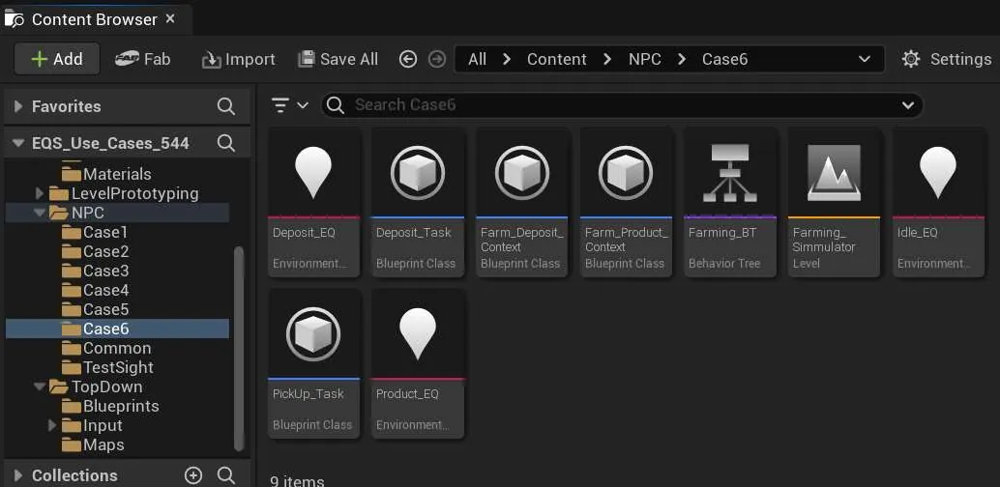

# Farming EQS — Report

> English translation of the original report (Spanish) for *Technologies III*, Game Design & Development degree (UDIT), academic year 2024/2025. Submitted 29/01/2025.
> Asset names are those of the original submission; the project README lists the current ones.
> Author: Miguel Rodríguez Gallego.

## 1. Introduction

Farming EQS was developed to practise artificial-intelligence techniques for games in Unreal Engine 5. The goal is a simulated environment where NPC agents collect resources spread over an area, using the Environment Query System (EQS), Behavior Trees and a Blackboard.

## 2. Goals

**Main goal:** a complete resource-gathering system run by autonomous agents with reactive AI in a dynamic environment.

**Secondary goals:**

- Configure the resources and their dynamic spawning.
- Implement storage buildings with storage logic and product types.
- Program agents whose decisions are driven by Behavior Trees and EQS.
- Build a working level that can be configured from the editor.

## 3. Architecture

Main components:

- **Farm_Product**: collectable resource.
- **Farm_Product_Spawner**: resource generator.
- **Farm_Deposit**: resource storage.
- **NPC_Character**: collector NPC.
- **Farmer_Ability**: collection logic (actor component).
- **ProductTypes** enum: product types that appear on the farms.
- EQS queries and contexts used by the Behavior Tree for the collection logic.

## 4. Data flow

1. **Generation**: Farm_Product_Spawner spawns Farm_Products of a random type.
2. **Perception**: NPC_Character finds resources with EQS.
3. **Collection**: the agent picks up the resource and carries it.
4. **Storage**: the resource is delivered to a suitable Farm_Deposit.
5. **Update**: the Blackboard is updated and the Behavior Tree continues.

## 5. Implementation by module

### 5.1. Resource (Farm_Product)

- Collectable object with a configurable type (`ProductTypes` enum).
- Visually different per type (blue, green or red material).
- Fixed cube size.

### 5.2. Spawn point (Farm_Product_Spawner)

- Spawns resources with a probability per type.
- Configurable spawn interval (timer).
- Editable spawn area (collision sphere or box).

### 5.3. Storage (Farm_Deposit)

- Stores resources by type in an array.
- Configurable capacity and allowed types.
- Checks the free capacity before accepting a resource.

### 5.4. Agent (NPC_Character)

- Uses a Behavior Tree and a Blackboard.
- Picks up, carries and delivers resources.
- Uses EQS to find nearby resources, and only collects the types it is configured for.
- Looks for a valid storage with free space.

**EQS query:** filter by resource type and maximum range from the NPC.

**Behavior Tree (Farming_BT):**

1. Select the closest resource.
2. Switch the state to "Collecting".
3. Move to it.
4. Check for a storage and deposit the resource.

## 6. Methodology and tools

- Engine: Unreal Engine 5.4.
- Implementation: Blueprints.
- AI: Behavior Tree, Blackboard, EQS.
- Version control: GitHub.
- Testing: logs, visual debugging and profiling.

## 7. Testing and validation

- Random spawning under different configurations.
- Several agents collecting at the same time.
- Deliveries to the right storage according to type and capacity.
- EQS queries validated with the EQS debugger.

## 8. Development log

| Week | Work |
|------|------|
| 1 | Base architecture and resources |
| 2 | Spawn points |
| 3 | Storage logic |
| 4 | Agent AI and EQS |
| 5 | Integration and testing |
| 6 | Tuning, documentation and presentation |

Obstacles overcome:

- Learning EQS and how to debug it.
- Synchronising several agents and storages.

## 9. Conclusions and next steps

The project gave hands-on experience with AI systems in Unreal Engine, and the modular approach made iteration easy.

Next steps:

- Optimisation with multithreading.
- A better interface to observe the simulation in real time.
- Priorities per resource.

## 10. Bibliography

- Unreal Engine 5 official documentation: *Behavior Trees* and *Environment Query System*.
- *Game AI Pro* (S. Rabin, ed.).
- *AI for Games* — Ian Millington.
