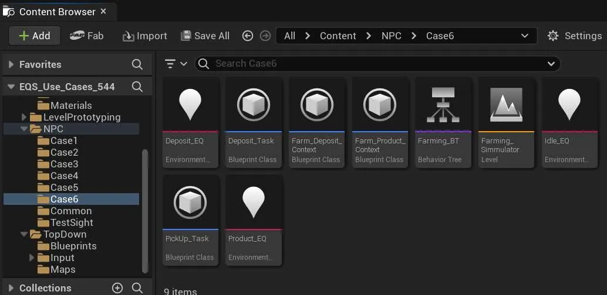

# 04 · Farming EQS

AI project for the course *Technologies III* (UDIT, 2024/25). It starts with a set of Environment
Query System (EQS) study cases and ends with a small farming simulation where NPCs autonomously
find, collect and deliver resources.

**Engine:** Unreal Engine 5.8 · **Tech:** Blueprints, Behavior Trees, Blackboard, EQS · **Report:** [Docs/Report.md](Docs/Report.md)

## Contents

### EQS study cases (`Content/NPC/`)

`Case1`–`Case5` and `TestSight`: one map, Behavior Tree and EQS query per case, sharing a common NPC,
Blackboard and contexts (`NPC/Common/`). They explore generators, tests, contexts (player / NPC) and
line-of-sight checks. `ST_ExampleCases` lists them.

### Farming simulation (`NPC/Case6/Farming_Simmulator` map, the default map)

| Element | Role |
|---------|------|
| `Farm_Product` (+ Grapes, Lettuce, Tomato) | Collectable resource with a type (`ProductTypes` enum) and a colour per type |
| `Farm_Product_Spawner` | Spawns resources in an editable area, on a timer, with per-type probabilities |
| `Farm_Deposit` | Storage that accepts certain types and checks its capacity |
| `NPC_Character` + `Farmer_Ability` | Collector NPC and its pick-up / carry / deliver logic |
| `Farming_BT`, `PickUp_Task`, `Deposit_Task` | Behavior Tree and custom tasks |
| `Product_EQ`, `Deposit_EQ`, `Idle_EQ` + contexts | Queries: nearest resource of an allowed type within range, a valid deposit with free space, idle position |

**Flow:** the spawner creates a product → the NPC finds it with EQS → walks to it and picks it up →
EQS finds a valid deposit → delivers it → the Blackboard updates and the tree loops.

Validated with several agents at once and with the EQS debugger.

## Where my work is

`Content/NPC/` and `Content/Farming_Simulator/`. The rest (`TopDown`, `Cursor`, `Characters`,
`LevelPrototyping`) comes from the Top Down template.

> The maps store each actor in its own file (One File Per Actor) and those files reference the
> Blueprints by path, so the assets keep their original names and folders.
