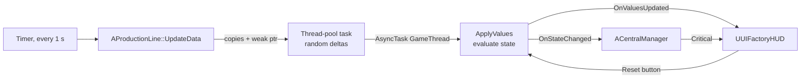

# 05 · Factory (C++)

Real-time simulation of an automated factory with three production lines, written in **C++** for the
course *Tecnologías III* (UDIT, 2024/25). Each line updates its values on a background task and
reports state changes to a central manager through delegates; the HUD shows everything live and the
player can react when a line becomes critical.

<!-- MEDIA: GIF of the HUD with a line going Critical and being reset. -->

**Engine:** Unreal Engine 5.4 · **Tech:** C++, UMG · **Report:** [Documentation_ES.pdf](Documentation_ES.pdf) (Spanish)

## Architecture

| Class | Responsibility |
|-------|----------------|
| [`AProductionLine`](Project/Source/factory/ProductionLine.h) | Simulates a line (efficiency, resources, state). Computes new values on the thread pool and applies them on the game thread. Broadcasts `OnStateChanged` and `OnValuesUpdated`. Thresholds and timings are editable properties. |
| [`ACentralManager`](Project/Source/factory/CentralManager.h) | Registers the lines (sorted by `LineID`), subscribes to their delegates, creates the HUD and raises the warning on `Critical`. |
| [`UUIFactoryHUD`](Project/Source/factory/UIFactoryHUD.h) | UMG base class for the HUD (`BP_ImprovedFactoryHUD`): bars and state per line, critical warning, reset of the whole factory. |
| [`UEmergencyMiniGame`](Project/Source/factory/EmergencyMiniGame.h) | Widget base class for the emergency sequence: countdown, restore the line on success, `OnEmergencyFailed` event for Blueprint. |

State rule: both values ≥ 75 → **Operational**, both ≥ 50 → **Warning**, otherwise **Critical**.

### Technical points

- **Threading done safely**: the worker only receives copies of the data and a `TWeakObjectPtr`; it never touches the actor. Results go back with `AsyncTask(ENamedThreads::GameThread)`, so UObjects and delegates are only used on the game thread.
- **Single update path**: timer updates, resets and the emergency restore all go through `ApplyValues`, so the manager and the HUD always get notified.
- **Event-driven UI**: the HUD subscribes to `OnValuesUpdated` instead of polling the lines.
- **GC-safe references**: every UObject reference is a `UPROPERTY` (`TObjectPtr`).
- **Logging**: `LogFactory` category (on-screen messages can be switched off in the manager).

## Build & run

1. Right-click `Project/factory.uproject` → *Generate Visual Studio project files*.
2. Build `factoryEditor` (Development Editor, Win64) or open the `.uproject` and let it compile.
3. The editor opens `L_Factory`. Press Play.

## Where my work is

Everything in `Project/Source/factory/` and `Project/Content/` (`BP_FactoryManager`, `BP_ImprovedFactoryHUD`, `L_Factory`).
