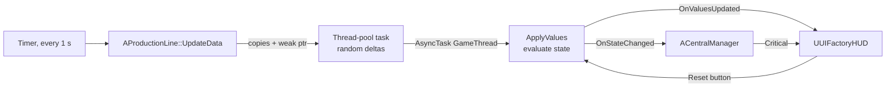

# 05 · Factory (C++)

Real-time simulation of an automated factory with three production lines, written in **C++** for the
course *Tecnologías III* (UDIT, 2024/25). Each line updates its values on a background task and
reports state changes to a central manager through delegates; the HUD shows everything live and the
player can react when a line becomes critical.

**Engine:** Unreal Engine 5.8 · **Tech:** C++20, UMG, GoogleTest · **Report:** [Docs/Report.md](Docs/Report.md)

## Architecture

| Class | Responsibility |
|-------|----------------|
| [`AProductionLine`](Project/Source/factory/ProductionLine.h) | Simulates a line (efficiency, resources, state). Computes new values on the thread pool and applies them on the game thread. Broadcasts `OnStateChanged` and `OnValuesUpdated`. Thresholds and timings are editable properties. |
| [`ACentralManager`](Project/Source/factory/CentralManager.h) | Registers the lines (sorted by `LineID`), subscribes to their delegates, creates the HUD and raises the warning on `Critical`. |
| [`UUIFactoryHUD`](Project/Source/factory/UIFactoryHUD.h) | UMG base class for the HUD (`WBP_FactoryHUD`): bars and state per line, critical warning, reset of the whole factory. |
| [`UEmergencyMiniGame`](Project/Source/factory/EmergencyMiniGame.h) | Widget base class for the emergency sequence: countdown, restore the line on success, `OnEmergencyFailed` event for Blueprint. |

| [`FactoryRules`](Project/Source/factory/Core/FactoryRules.h) | Engine-independent rules (state evaluation, clamping, random-walk step) shared by the actor, the unit tests and the console simulation. |

State rule: both values ≥ 75 → **Operational**, both ≥ 50 → **Warning**, otherwise **Critical**.

### Technical points

- **Threading done safely**: the worker only receives copies of the data and a `TWeakObjectPtr`; it never touches the actor. Results go back with `AsyncTask(ENamedThreads::GameThread)`, so UObjects and delegates are only used on the game thread.
- **Single update path**: timer updates, resets and the emergency restore all go through `ApplyValues`, so the manager and the HUD always get notified.
- **Event-driven UI**: the HUD subscribes to `OnValuesUpdated` instead of polling the lines.
- **GC-safe references**: every UObject reference is a `UPROPERTY` (`TObjectPtr`).
- **Logging**: `LogFactory` category (on-screen messages can be switched off in the manager).

## Tests

| Level | Where | How to run |
|-------|-------|-----------|
| Unit tests (GoogleTest, 20 tests) | [`Tests/`](Tests/) | `cmake -S Tests -B build && cmake --build build && ctest --test-dir build` — run by CI on Linux and Windows |
| Console simulation (smoke test) | [`Tests/FactorySim.cpp`](Tests/FactorySim.cpp) | `build/factory_sim --steps 120 --delta 10` — run by CI; also attached to every release |
| Unreal Automation Tests | [`Project/Source/factory/Tests/`](Project/Source/factory/Tests/ProductionLineTests.cpp) | Editor: *Tools → Session Frontend → Automation*, filter `Factory`. Headless: `UnrealEditor-Cmd.exe factory.uproject -ExecCmds="Automation RunTests Factory; Quit" -unattended -nullrhi` |

The unit tests cover the state thresholds, clamping (including NaN), the random-walk step, state
change reporting, determinism with a fixed seed, restore/reset and the emergency countdown. The
Automation Tests spawn a real `AProductionLine` in a test world and check `RestoreLine`/`ResetLine`.

## Build & run

1. Right-click `Project/factory.uproject` → *Generate Visual Studio project files*.
2. Build `factoryEditor` (Development Editor, Win64) or open the `.uproject` and let it compile.
3. The editor opens `L_Factory`. Press Play.

## Where my work is

Everything: `Project/Source/factory/`, `Tests/` and `Project/Content/` (`Factory/Blueprints/BP_FactoryManager`, `Factory/UI/WBP_FactoryHUD`, the `L_Factory` map).
