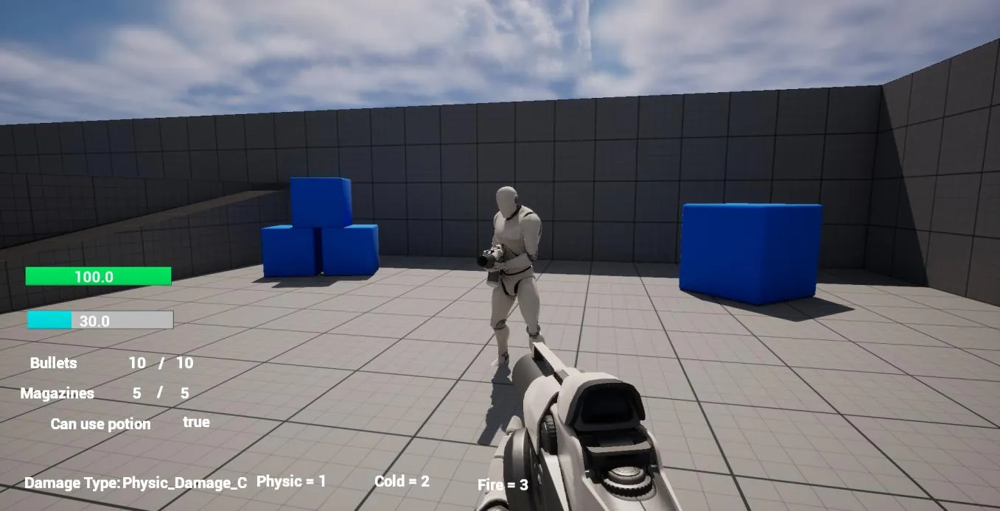
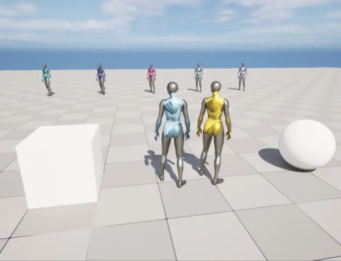
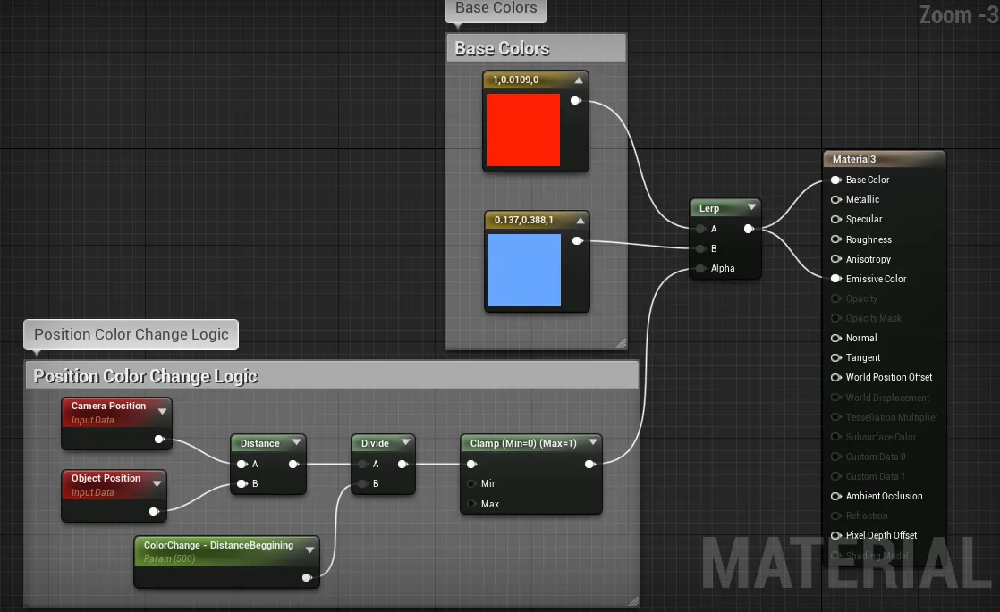
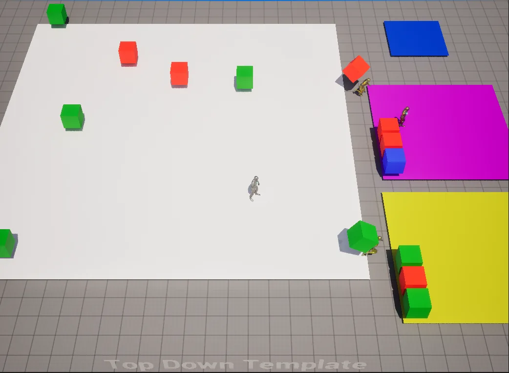
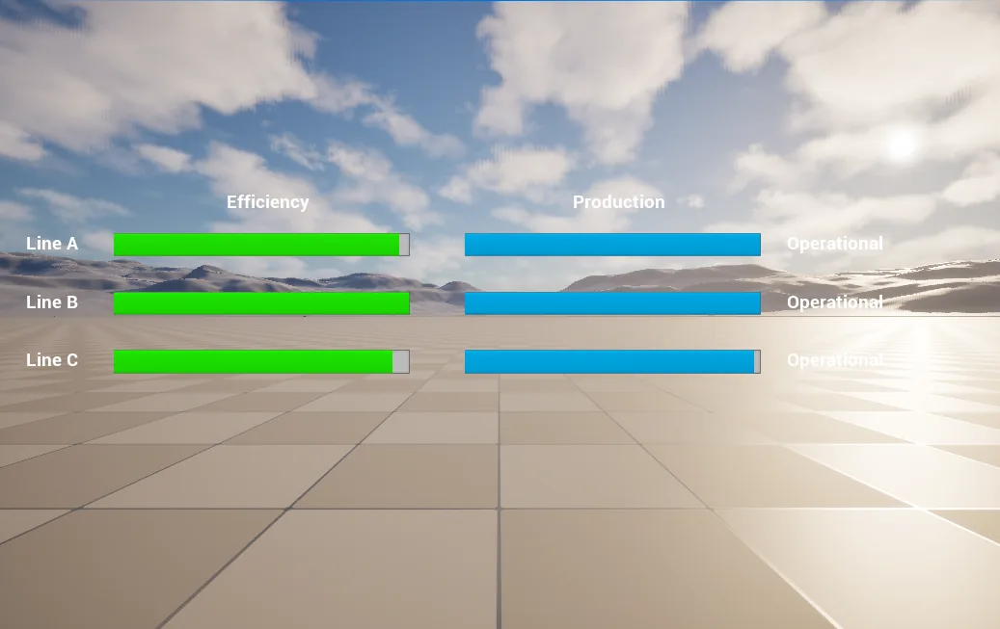

# UE Lab — Unreal Engine 5 study projects

[](https://github.com/miguelrg14/UE_Lab/actions/workflows/ci.yml)


Five Unreal Engine projects I built while studying Game Design & Development (ESNE and UDIT,
2022–2025). Each one focuses on a different engine system: materials, networked gameplay, pawn
possession and replication, AI with Behavior Trees + EQS, and a gameplay simulation written in C++.
All of them are upgraded to **Unreal Engine 5.8**.

| Multiplayer FPS | Pawn Change | Materials |
|:---:|:---:|:---:|
|  |  |  |

| Farming EQS | Factory (C++) |
|:---:|:---:|
|  |  |

| # | Project | What it shows | Tech |
|---|---------|---------------|------|
| 01 | [Materials](01_Materials/) | Material graph authoring: animated emissives, panners, distance-based colour, fresnel, master materials + instances, reverse-engineered materials | Material Editor |
| 02 | [Multiplayer FPS](02_Multiplayer/) | Listen-server FPS: server/multicast RPCs, replicated aim pitch, two weapon modes, damage types with immunity, Chaos destruction, Enhanced Input | Blueprints |
| 03 | [Pawn Change](03_Pawn-Change/) | Multiplayer pawn swapping, tag-based spawning from the GameMode, random colours replicated with RepNotify | Blueprints |
| 04 | [Farming EQS](04_Environment-Query-System/) | Autonomous NPCs that find, collect and deliver resources using Behavior Trees, Blackboard, EQS queries and custom contexts/tasks | Blueprints, AI |
| 05 | [Factory](05_Factory/) | Real-time factory simulation: dynamic multicast delegates, thread-pool tasks marshalled back to the game thread, UMG HUD driven from C++, unit tests | **C++**, UMG |

## Skills covered

- **Gameplay framework**: GameMode, PlayerController, Pawn/Character, possession, spawning.
- **Networking**: replicated variables, RepNotify, Run on Server / Multicast / Owning Client events, what each client sees (first-person arms vs third-person body).
- **AI**: Behavior Trees, Blackboards, EQS queries, contexts and custom tasks, EQS debugging.
- **C++**: `UCLASS`/`UPROPERTY`/`UFUNCTION` exposed to Blueprints, dynamic multicast delegates, timers, `Async` + `AsyncTask` to the game thread, weak object pointers, UMG widgets in C++, a custom log category, engine-independent core code.
- **Testing & CI**: GoogleTest unit tests, Unreal Automation Tests, GitHub Actions on Linux and Windows.
- **Rendering / tech art**: material graphs, material instances and parameters.
- **Input & UI**: Enhanced Input (mapping contexts + actions), UMG HUDs.
- **Physics**: Chaos destruction (geometry collections + fields), radial damage and impulses.

## Repository layout

```
NN_ProjectName/
├── Project/            # The Unreal project (open the .uproject with UE 5.8)
├── Docs/Report.md      # The original technical report, translated to English, with images
└── README.md           # What the project does and where the work is
05_Factory/Tests/       # CMake project: unit tests + console simulation of the Factory core
tools/check_repo.py     # Repository checks run in CI
```

## Running the projects

1. Install **Unreal Engine 5.8** (Epic Games Launcher).
2. Open `NN_ProjectName/Project/<Name>.uproject`.
3. **Factory (C++)** also needs Visual Studio 2022 with the *Game development with C++* workload:
   right-click `factory.uproject` → *Generate Visual Studio project files*, or just open the
   `.uproject` and let the editor compile the module.

The multiplayer projects are tested with **Play → Number of Players = 2, Net Mode = Play As Listen Server**.

### Try it without the engine

Every [release](https://github.com/miguelrg14/UE_Lab/releases) includes `factory_sim`, a console build
of the Factory simulation for Windows and Linux. It uses exactly the same rules as the Unreal project:

```
factory_sim --lines 3 --steps 120 --seed 42 --delta 10
```

## Tests and CI

[GitHub Actions](.github/workflows/ci.yml) runs on every push and pull request:

| Job | What it checks |
|-----|----------------|
| Factory core (Ubuntu, Windows) | Builds the engine-independent Factory core with `-Werror`, runs 20 GoogleTest unit tests and the console simulation |
| Repository checks | Every `.uproject` targets UE 5.8, no build output or office documents are committed, every Markdown link and image resolves |

The Unreal side of Factory has its own Automation Tests (`Factory.ProductionLine.*`), run from the
editor (*Tools → Session Frontend → Automation*) because GitHub-hosted runners do not have Unreal Engine.

## Third-party content

These projects use Epic Games template content (First Person, Third Person and Top Down templates,
Starter Content, mannequins) and the free *Animation Starter Pack* from Fab. That content belongs to
its authors and is subject to their licences; only the original work in this repository is covered
by the [LICENSE](LICENSE). Unused template content has been removed, and every project README lists
which folders are mine.

## Author

**Miguel Rodríguez Gallego** — game developer (Unity / C#, Unreal Engine / C++), Vigo, Spain.
